# 面向资产管理的机器学习

本项目实现了 Marcos López de Prado 教授所著的[《面向资产管理的机器学习》（量化金融要素丛书）](https://www.amazon.com/Machine-Learning-Managers-Elements-Quantitative/dp/1108792898)中的代码片段和练习，并提供第 2—8 章的逐章 Notebook，在同一份基金数据上对照原实现与 skfolio。

原章节源码保留在 [Machine_Learning_for_Asset_Managers/](Machine_Learning_for_Asset_Managers/)。Notebook 区分原算法、兼容复现和替代方法；没有直接对应接口的章节会明确说明，不将不同算法视为数值等价实现。

## 快速开始

在项目根目录使用已配置的 `ml4t` 环境。依赖版本统一维护在 [requirement.txt](requirement.txt)，需要安装时执行：

```powershell
conda activate ml4t
python -m pip install -r requirement.txt
```

在支持 Notebook 的 IDE 或已有的 Jupyter 前端打开下表中的任意一本，选择 `ml4t` 环境对应的内核，重启内核并从头运行全部单元。每本均可独立运行，不依赖其他 Notebook 的执行状态；已保存的输出可直接阅读。

不需要执行 `pip install .`。项目根目录可直接导入本地模块；[setup.py](setup.py) 仅保留原打包配置，不作为 Notebook 的依赖清单。第 8 章不导入原脚本中未使用的 CUDA 依赖，因此运行这些 Notebook 不需要安装 `cupy`。

## 逐章 Notebook 导航

| 章节 | Notebook | 主要对照与边界 |
| --- | --- | --- |
| 第 2 章：去噪与去市场成分 | [ch2_denoising_and_detoning.ipynb](ch2_denoising_and_detoning.ipynb) | 原去噪／去市场成分与 `DenoiseCovariance`／`DetoneCovariance`；分开比较关闭正定修复和默认配置。 |
| 第 3 章：距离度量 | [ch3_distance_metrics.ipynb](ch3_distance_metrics.ipynb) | 角距离、互信息和信息变差；明确分箱与归一化口径，运行固定 20 箱的全资产互信息矩阵。 |
| 第 4 章：最优聚类 | [ch4_optimal_clustering.ipynb](ch4_optimal_clustering.ipynb) | ONC Base／Top 与 `HierarchicalClustering`；统一成对距离评分，比较簇结构及方法一致性，而非宣称算法等价。 |
| 第 5 章：金融标签 | [ch5_financial_labels.ipynb](ch5_financial_labels.ipynb) | 原回溯趋势扫描与日期语义修正版；skfolio 无直接对应接口，本章使用固定基金池中的单资产示例。 |
| 第 6 章：特征重要性 | [ch6_feature_importance_analysis.ipynb](ch6_feature_importance_analysis.ipynb) | 原 MDI、MDA 兼容复现与 scikit-learn 参考；前向验证及聚类重要性，非 skfolio 直接实现。 |
| 第 7 章：组合构建 | [ch7_portfolio_construction.ipynb](ch7_portfolio_construction.ipynb) | 解析 GMV、原 NCO 与 `MeanRisk`、`NestedClustersOptimization`、HRP；同簇受控对照与层次聚类＋前向验证分开。 |
| 第 8 章：测试集过拟合 | [ch8_testing_set_overfitting.ipynb](ch8_testing_set_overfitting.ipynb) | 最大夏普期望、9 个策略试验、PSR／DSR；显式展示原公式修正与测试集选优偏差。 |

## 公共模块与数据口径

[notebook_common.py](notebook_common.py) 集中实现数据读取、训练期资产筛选、收益切分、随机种子与绘图配置，以及计时、日志压缩和矩阵诊断。章节算法仍保留在各自 Notebook 中。

```python
from notebook_common import load_data, setup_notebook

setup_notebook(seed=42)
data = load_data()
X_train, X_test = data.X_train, data.X_test
```

- 数据来自 [data/hs_funds_prices.parquet](data/hs_funds_prices.parquet)，以 `timestamp` 为时间索引，其余列为基金价格；按日期排序并保留时区。
- 使用最近 1,260 个价格观测：前 1,008 个用于训练，后 252 个用于测试。训练收益为 1,007 行；首个测试收益使用最后一个训练价格作为前一期价格。
- 非有限或非正价格先标记为缺失，使用 `pct_change(fill_method=None)` 计算简单日收益，不做前向或后向填充。缺失价格会影响当日及下一日收益，不把跨缺失日期的涨跌当作单日收益。
- 仅在训练收益上拟合 `skfolio.pre_selection.SelectComplete(drop_assets_with_internal_nan=True)` 和 `DropZeroVariance`。后者的总体方差阈值换算为 `1e-12 * (n-1) / n`，保持样本方差（`ddof=1`）大于 `1e-12` 的原筛选口径。
- 基金代码排序后固定资产集合，默认使用全部合格基金。测试期不重新选择基金，只删除全部选定资产不能同时提供有效收益的日期。

当前数据的默认运行规模如下；更新数据后以 `data.summary()` 为准：

| 项目 | 当前结果 |
| --- | --- |
| 合格基金数 | 488 |
| 训练收益 | 1,007 行，2021-07-14 至 2025-09-04 |
| 测试候选日期 | 252 个，2025-09-05 至 2026-09-18 |
| 共同有效测试日期 | 124 个，覆盖率 49.21% |
| 排除测试日期 | 128 个 |

初始化仅展示简洁数据摘要，不打印解释器、依赖版本或文件指纹。完整资产列表和排除日期可按需查看 `data.assets`、`data.excluded_test_dates`，原始测试收益保留在 `data.X_test_raw`。

## 运行开关与结果解释

- 含高成本扩展的章节默认设置 `RUN_EXPENSIVE = False`，不影响主对照实验使用全部合格基金。第 3 章对默认 Freedman 分箱设置单个二维直方图 400 万格的保护；超限会明确提示未运行，不会静默减少资产或更换分箱规则。
- `ML4AM_SMOKE=1` 仅用于自动化冒烟测试，截取排序后的前 24 只合格基金。正常全量运行不设置该环境变量；不要将小规模输出覆盖为全量结果。
- `DenoiseCovariance` 默认使用 `EmpiricalCovariance()`。关闭外层 `nearest` 不会关闭内层修复；第 2 章的受控对照同时关闭两层，默认配置另行展示。去市场成分后的矩阵理论上奇异，不能将其当作完整组合风险。
- 第 7—8 章的主优化对照统一使用目标尺度 `1e4` 和 CLARABEL 容差 `1e-12`，以处理极小方差和病态协方差的数值问题；第 7 章另保留默认精度诊断。优化警告和失败记录不会被隐藏，近似解不等于达到全部指定容差。
- 已对 7 本 Notebook 分别完成小规模与默认全量执行，并保存全量输出；公共模块重构前后的资产顺序和训练／测试收益已逐项验证一致。默认关闭的扩展不在这次全量验证范围内。

**这些结果用于算法研究，不是连续、可交易的回测，也不是投资建议。** 测试期仅比较共同有效日期，未将缺失收益视为零；价格复权口径尚未确认，还需考虑存续偏差、交易成本和实际执行条件。第 8 章故意在测试结果上选优以展示选择偏差，该测试集不是选优后的独立验证集。ARI／NMI 衡量聚类方法一致性，PSR／DSR 接口返回概率型统计量，均不应误读为投资绩效保证。

## 原项目章节笔记

以下保留原项目的章节说明、公式记录与 `img/` 中的示意图；这些图不是上述基金数据实验的输出。实现差异、公式修正和适用限制以对应 Notebook 中的受控对照说明为准。

### ONC 算法注意事项

注意：书中第 4 章的“最优聚类数量”（Optimal Number of Clusters，ONC）算法实现存在一个错误。 
（de Prado 和 Lewis 于 2018 年发表的论文《使用无监督学习方法识别虚假投资策略》中的代码与书中不同，但同样存在错误。）
https://quant.stackexchange.com/questions/60486/bug-found-in-optimal-number-of-clusters-algorithm-from-de-prado-and-lewis-201

ONC 对子空间采用的分治方法可能存在问题：如果将一个子空间嵌入具有较大特征值的空间，较大的空间可能会扭曲子空间中识别出的簇。ONC 正是这样做的——它将子空间嵌入相关矩阵中最大特征值所对应的空间。关于这一问题的更严谨说明，请参阅： 
https://math.stackexchange.com/questions/4013808/metric-on-clustering-of-correlation-matrix-using-silhouette-score/4050616#4050616

还应研究其他聚类算法，例如层次聚类。

## 第 2 章 去噪与去除市场成分

Marčenko–Pastur 理论概率密度函数与经验密度函数：
| 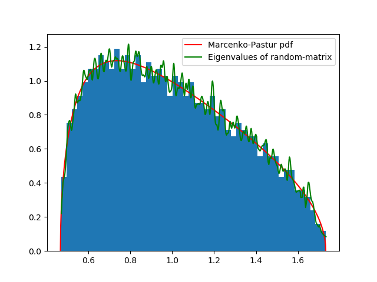 | 
|:--:| 
| *图 2.1：Marčenko–Pastur 理论概率密度函数与经验密度函数。* |


使用恒定残差特征值法对包含信号的随机矩阵进行去噪，即将随机特征值设为固定值。参见代码片段 2.5。
| 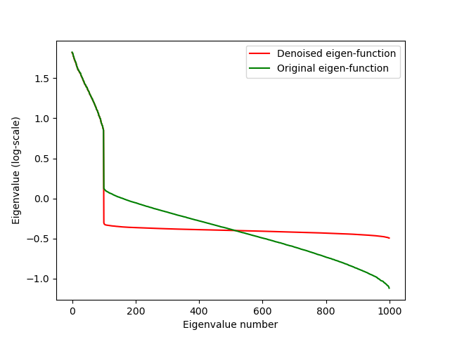 | 
|:--:| 
| *图 2.2：应用残差特征值法前后的特征值对比。* |

去除市场成分后的协方差矩阵可用于计算最小方差投资组合。有效前沿是最小方差前沿中从最小方差投资组合开始向上延伸的部分。去噪后的协方差矩阵对变化更不敏感，因此更加稳定。

注意：练习 2.7：“扩展代码片段 2.2 中的 fitKDE 函数，使其通过交叉验证估计 bWidth（带宽）的最优值。”

脚本 [ch2_fitKDE_find_best_bandwidth.py](Machine_Learning_for_Asset_Managers/ch2_fitKDE_find_best_bandwidth.py) 实现了这一过程，并生成了图 2.3 中的绿色核密度估计（KDE）曲线：
|  | 
|:--:| 
| *图 2.3：使用计算所得带宽绘制的 KDE 曲线（绿色），以及直方图和概率密度函数（PDF）。绿色曲线更加平滑。求得的带宽为：0.03511191734215131。* |

代码片段 2.3 使用包含信号的随机矩阵，直方图展示了该矩阵特征值的分布。随后，将 $fitKDE$ 的结果作为经验概率密度函数，用来估计理论概率密度函数的方差。因此，需要为 fitKDE 选择合适的带宽，才能找到理论 Marčenko–Pastur 概率密度函数（mp-pdf）最可能的方差。
| 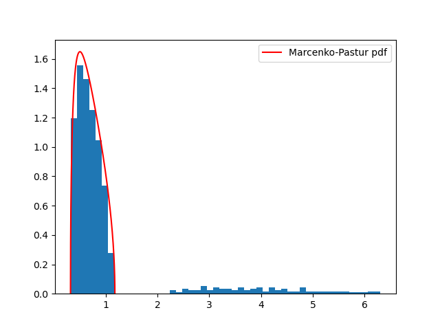 | 
|:--:| 
| *图 2.4：包含信号的矩阵特征值的直方图与概率密度函数。* |


## 第 3 章 距离度量

* 度量的定义： 
   1. 同一性：d(x,y) = 0 => x=y 
   2. 对称性：d(x,y) = d(y,x) 
   3. 三角不等式。 
   - 由 1、2、3 可推出非负性：d(x,y) >= 0 
* Pearson 相关系数
* 距离相关系数
* 角距离
* 基于信息论的相依性／熵依赖性
    - 交叉熵：  H[X] = - &Sigma;<sub>s &isin; S<sub>X</sub></sub> p[x] log (p[x])
    - Kullback–Leibler 散度：  D<sub>KL</sub>[p||q] = - &Sigma;<sub>s &isin; S<sub>X</sub></sub> p[x] log (q[x]/p[x]) = p[x] &Sigma;<sub>s &isin; S</sub> log (p[x]/q[x])
    - 交叉熵： H<sub>c</sub>[p||q] = H[x] = D<sub>KL</sub>[p||q]
    - 互信息：已知 Y 后，X 的不确定性减少的程度： I[X,Y] = H[X] - H[X|Y] = H[X] + H[Y] - H[X,Y] = E<sub>X</sub>[D<sub>KL</sub>[p[y|x]||p[y]]]
    - 信息变差：VI[X,Y] = H[X|Y] + H[Y|X] = H[X,Y] - I[X,Y]。它表示在给定另一个变量时，我们对某一变量所预期的不确定性：VI[X,Y] = 0 <=> X=Y
    - Kullback–Leibler 散度不是度量，而信息变差是度量。
   
 
 ```
 >>> ss.entropy([1./2,1./2], base=2)
1.0
>>> ss.entropy([1,0], base=2)
0.0
>>> ss.entropy([1./3,2./3], base=2)
0.9182958340544894
```
1. 抛掷公平硬币的信息量为 1 比特。
2. 确定性结果的信息量为 0 比特。
3. 抛掷非公平硬币的信息量小于 1 比特。


* 角距离： p_d = sqrt(1/2 - (1-rho(X, Y)))
* 绝对角距离： p_d = sqrt(1/2 - (1-|rho|(X, Y)))
* 平方角距离： p_d = sqrt(1/2 - (1-rho^2(X, Y)))

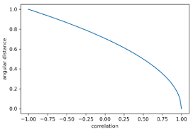  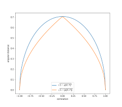 
标准角距离更适合只做多的投资组合，而平方角距离和绝对角距离更适合多空投资组合。 

## 第 4 章 最优聚类

使用无监督学习来最大化组内相似性，并最小化组间相似性。考虑一个形状为 N x F 的矩阵 X，其中包含 N 个对象和 F 个特征。利用这些特征计算 N 个对象之间的接近程度（如相关性、互信息），得到一个 NxN 矩阵。

聚类算法分为两类：划分式聚类和层次聚类。按聚类依据，还可以列出以下方法：
1. 基于连通性：层次聚类。
2. 基于质心：例如 k-means。
3. 基于分布：例如高斯分布。
4. 基于密度：寻找相互连通的高密度区域，例如 DBSCAN、OPTICS。
5. 基于子空间：在特征和观测两个维度上建模。[示例](https://quantdare.com/biclustering-time-series/)


生成随机分块相关矩阵可用于模拟具有相关性的金融工具。代码片段 4.3 提供了相应的工具，并使用代码片段 4.1 和 4.2 中定义的<i>最优聚类数量</i>（ONC）算法。与 k-means 不同，该算法不需要预先指定簇的数量，而是使用“肘部法”来决定何时停止增加簇。当簇内相关性高、簇间相关性低时，就达到了最优簇数。算法使用[轮廓系数](https://en.wikipedia.org/wiki/Silhouette_(clustering))来最小化组内距离，并最大化组间距离。 
| 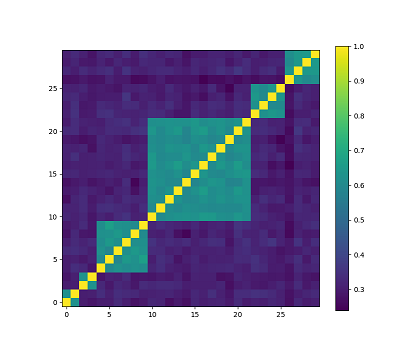 | 
|:--:| 
| *随机分块相关矩阵。浅色表示高相关性，深色表示低相关性。本例中，块数 K=6，最小块大小 minBlockSize=2，金融工具数量 N=30。* |
| 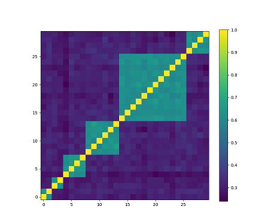 | 
| *将 ONC 算法应用于随机分块相关矩阵。ONC 识别出了所有簇。* |

## 第 5 章 金融数据标签

* 固定期限法
* 时间 K 线法
* 成交量 K 线法

三重障碍法要求持有头寸，直到满足以下任一条件：
1. 未实现盈利达到目标。
2. 未实现亏损达到限额。
3. 持仓持续的 K 线数量超过上限。

趋势扫描法：其思路是识别趋势，并在不设置任何障碍的情况下，让趋势尽可能长久、充分地延续。 

| 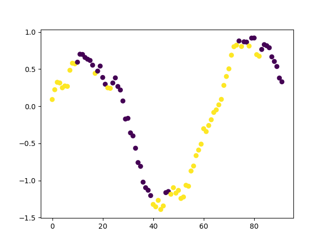 | 
|:--:| 
| *对叠加高斯噪声的正弦波进行趋势扫描标注的示例。* |

| 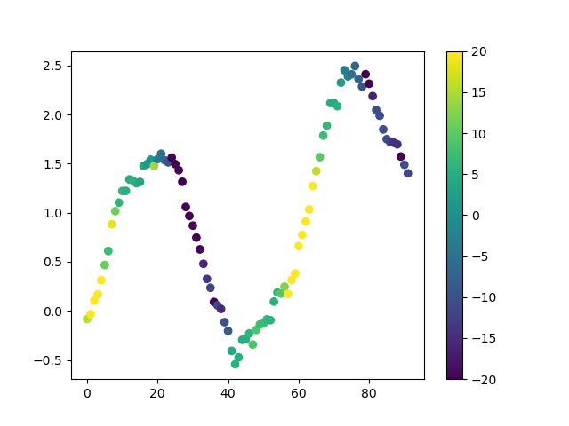 | 
|:--:| 
| *使用 t 值表示趋势置信程度的趋势扫描。1 表示对上涨趋势具有较高置信度，-1 表示对下跌趋势具有较高置信度。* |

除了书中介绍的向前扫描算法，也可以从最新数据点出发，按照窗口大小向后回溯。例如，最新数据点的索引为 20，窗口大小介于 3 到 10 天之间，回溯算法就会扫描从索引 17 到 20 的窗口，并逐步扩展至索引 11 到 20 的窗口。因此，这种方法只考虑最近的信息。


| 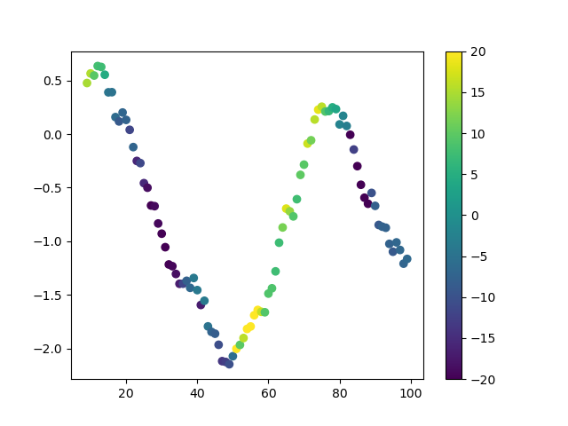 | 
|:--:| 
| *采用回溯方式并使用 t 值的趋势扫描。* |

## 第 6 章 特征重要性分析

<i>“p 值不衡量原假设或备择假设为真的概率，也不衡量结果的重要程度。”</i>
| 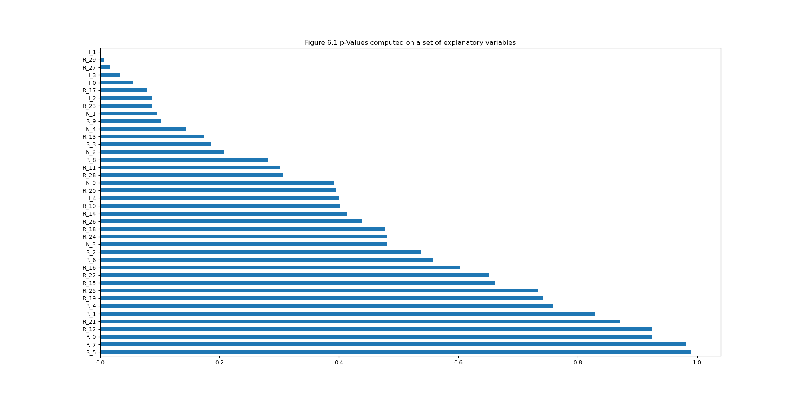 | 
|:--:| 
| *对一组包含信息性、冗余性和噪声性特征的解释变量计算 p 值。解释变量的 p 值并不是最高的。* |

“回测不是研究工具，特征重要性才是。”（López de Prado）平均不纯度下降（Mean Decrease Impurity，MDI）算法解决了 p 值所面临的四个问题中的三个：
1. MDI 不强制规定任何树结构或代数形式，也不依赖残差的随机特性或分布特性（例如 y=b<sub>0</sub>+b<sub>1</sub>*x<sub>i</sub>+&epsilon;）。
2. beta 系数由单一样本估计，而 MDI 依赖自助采样，因此可以通过增加随机森林集成中的树的数量来降低方差。
3. MDI 的目标不是估计某个给定代数方程的系数（b_hat_0、b_hat_1），以描述原假设的概率。
4. 由于没有交叉验证，MDI 无法纠正样本内计算所带来的问题。

| 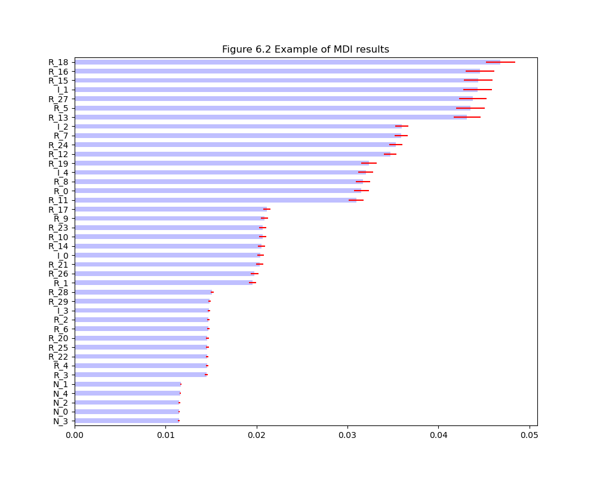 | 
|:--:| 
| *MDI 算法示例。* |

图 6.4 显示，ONC 正确识别出了六个相关簇：每个信息性特征对应一个簇，另有一个噪声特征簇。算法还将冗余特征分配到其来源信息性特征所在的簇中。由于簇间相关性较低，因此不需要用残差替换这些特征。
| 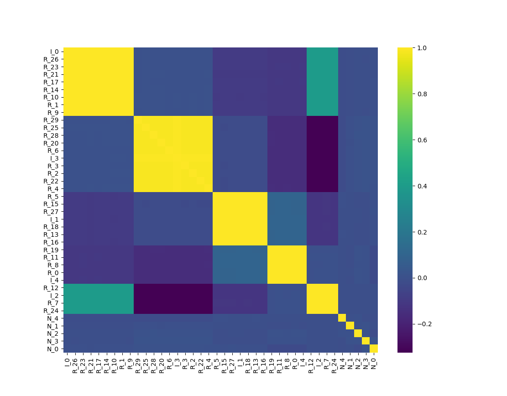 | 
|:--:| 

接下来，对聚类后的数据应用聚类 MDI 方法：
| 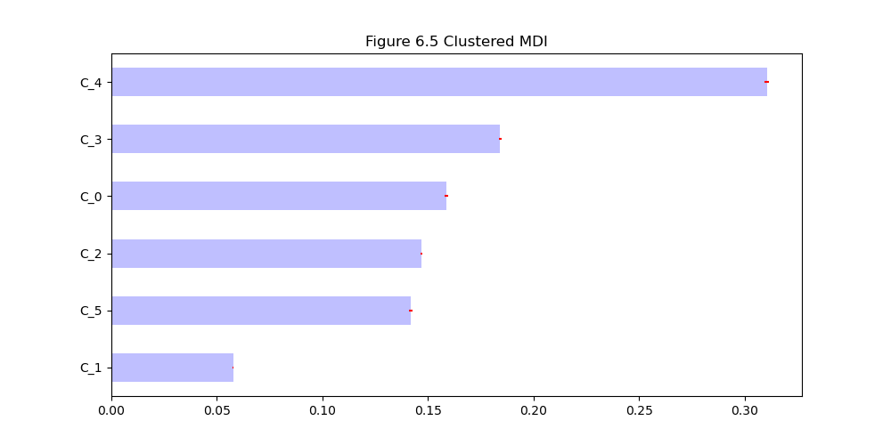 | 
|:--:| 
| *图 6.5：聚类 MDI。* |

聚类 MDI 的效果优于非聚类 MDI。最后，对这些数据应用聚类 MDA 方法：
| 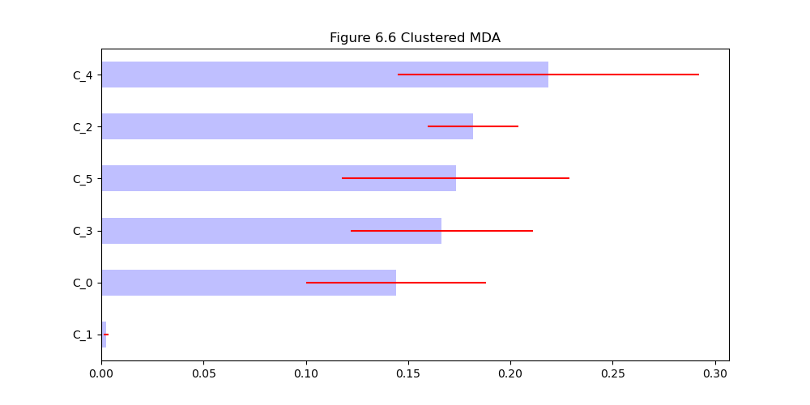 | 
|:--:| 
| *图 6.6：聚类 MDA。* |

结论：与噪声特征相关的 C_5 并不重要，其他簇的重要性则相近。

## 第 7 章 投资组合构建

投资组合凸优化可用于求解最小方差投资组合和最大夏普比率。

条件数的定义：最大特征值与最小特征值之比的绝对值，即 A_n_n / A_m_m。条件数反映了协方差结构所引起的不稳定性。
迹的定义：trace = sum(diag(A))，即矩阵对角线元素之和。

时间序列之间的高度相关性意味着相关矩阵具有较高的条件数。

### Markowitz 诅咒
只有当相关系数 $ro = 0$，即不存在相关性时，相关矩阵 C 才是稳定的。

层次风险平价（HRP）在样本外蒙特卡洛实验中的表现优于 Markowitz 方法，但在样本内并非最优。

代码片段 7.1 展示了信号引起的相关矩阵不稳定性。
```
>>> corr0 = mc.formBlockMatrix(2, 2, .5)
>>> corr0
array([[1. , 0.5, 0. , 0. ],
       [0.5, 1. , 0. , 0. ],
       [0. , 0. , 1. , 0.5],
       [0. , 0. , 0.5, 1. ]])
>>> eVal, eVec = np.linalg.eigh(corr0)
>>> print(max(eVal)/min(eVal))
3.0
```

| 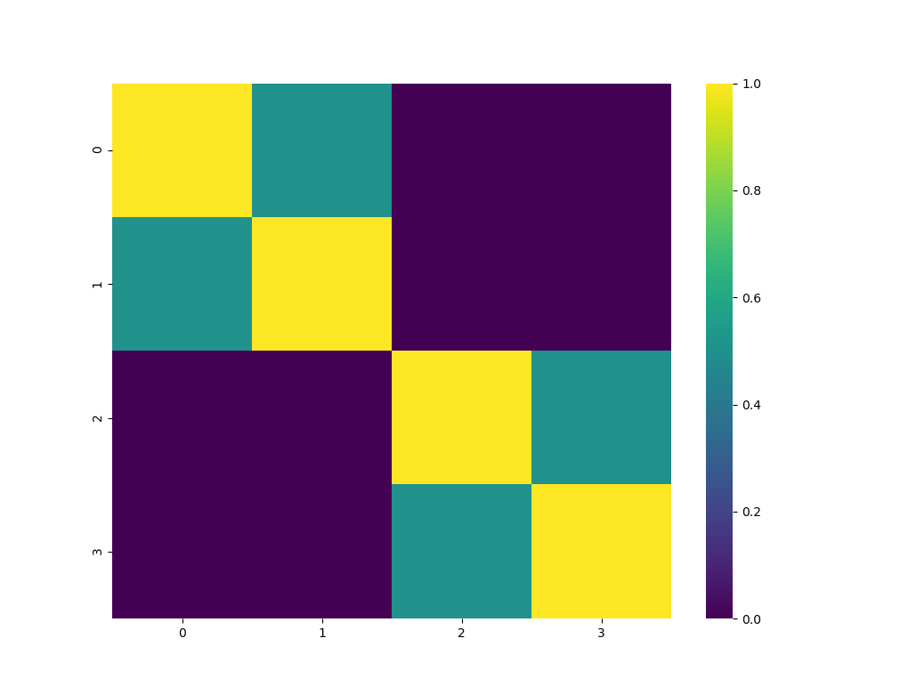 | 
|:--:| 
| *图 7.1：分块对角相关矩阵的热力图。* |

代码片段 7.2 创建了类似的分块对角矩阵，但其中一个块占主导地位。然而，其条件数保持不变。
```
>>> corr0 = block_diag(mc.formBlockMatrix(1,2, .5))
>>> corr1 = mc.formBlockMatrix(1,2, .0)
>>> corr0 = block_diag(corr0, corr1)
>>> corr0
array([[1. , 0.5, 0. , 0. ],
       [0.5, 1. , 0. , 0. ],
       [0. , 0. , 1. , 0. ],
       [0. , 0. , 0. , 1. ]])
>>> eVal, eVec = np.linalg.eigh(corr0)
>>> matrix_condition_number = max(eVal)/min(eVal)
>>> print(matrix_condition_number)
3.0
```
这表明，仅降低两个块中某一个块的内部相关性，并不会降低条件数。这也说明，Markowitz 解的不稳定性可以追溯到占主导地位的块。
| 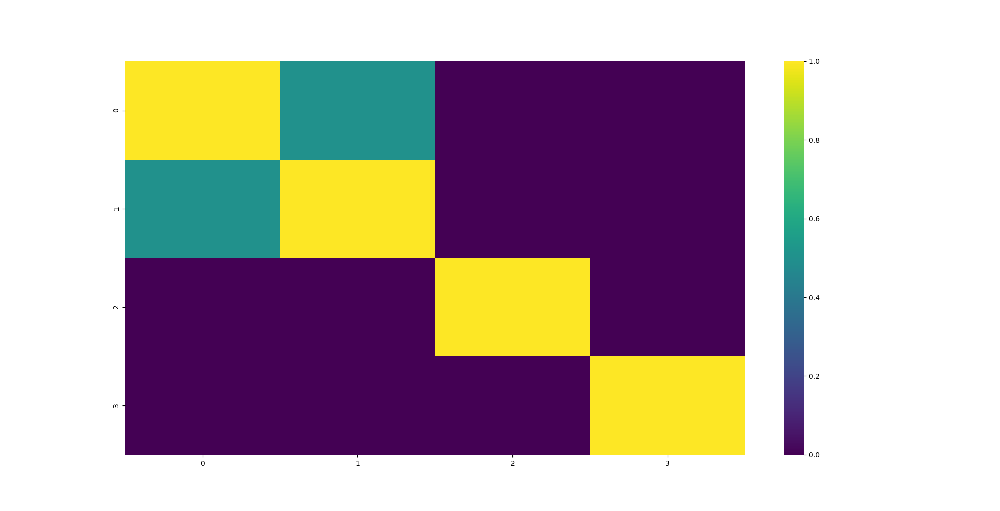 | 
|:--:| 
| *图 7.2：包含主导块的分块对角相关矩阵热力图。* |

### 嵌套聚类优化算法（NCO）

NCO 提供了一种策略，用于应对 Markowitz 诅咒对现有均值—方差配置方法的影响。
1. 第一步：对相关矩阵进行聚类。
2. 第二步：使用去噪后的协方差矩阵计算最优簇内配置。
3. 第三步：使用降维后的协方差矩阵计算最优簇间配置。该矩阵接近对角矩阵，因此优化问题接近 $ro$ = 0 时的理想 Markowitz 情形。

## 第 8 章 测试集过拟合

回测是对投资策略过去表现的历史模拟。在多重检验下，回测会受到选择偏差的影响，因为研究人员可能对历史数据进行数百万次测试，并只展示表现最好的结果，而这些结果往往存在过拟合。本章研究如何衡量选择偏差的影响。 

### 精确率与召回率
### 多重检验下的精确率与召回率
### 夏普比率

夏普比率 = μ/σ

### “虚假策略”定理

研究人员可能运行大量历史模拟，却只报告表现最好的一次（夏普比率最高的结果）。
最大夏普比率的分布与预期夏普比率并不相同，因此会产生多重重复试验下的选择偏差（SBuMT）。

### 实验结果

一项蒙特卡洛实验表明，即使预期夏普比率 E[sharp_ratio] 为 0，最大夏普比率的分布也会向较高值偏移（E[max(sharp_ratio)] = 3.26）。因此，即使不存在好的策略，某个投资策略也可能看起来很有前景。

当试验次数超过一次时，最大夏普比率的期望值会大于随机单次试验中夏普比率的期望值（假设真实夏普比率为 0，且方差 > 0）。
| 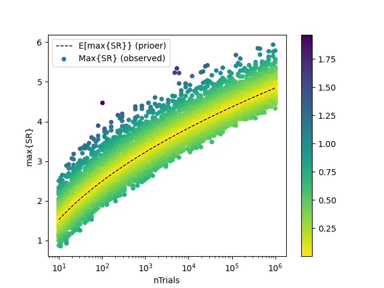 | 
|:--:| 
| *图 8.1：“虚假策略”定理的实验结果与理论结果对比。* |

### 折减夏普比率
“虚假策略”定理的主要结论是：除非 $max<sub>k</sub>{SR^<sub>k</sub>}>>E[max<sub>k</sub>{SR^<sub>k</sub>}],
否则，所发现的策略很可能是假阳性结果。

### 多重检验下的第二类错误
### 第一类错误与第二类错误的相互作用


## 附录 A：使用合成数据进行测试

合成数据可通过重采样或蒙特卡洛方法生成。
